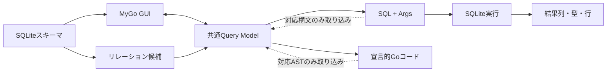

# QueryLab 設計

## 目的と範囲

SQLiteクエリをGoの宣言的データとして定義し、MyGoで同じ構造を視覚的に編集します。
SQL・Goコード・結果表を同じモデルから生成し、対応範囲内のSQL/Go編集をモデルに戻します。
JOINとリレーションの視覚的な構築も製品の範囲に含めます。

今回の実装はSELECTコアと一方向のSQL/Go生成までです。
参照会話にあるアシスタントの提案本文は内容参照だけで取得できませんでした。
そのため、引き継ぎ依頼に明記された要件を合意事項の記録としています。
MyGoの実体や既存APIを推測した依存コードは作成しません。

## データフロー

実線も将来実装を含む製品設計です。実装状況はREADMEと実装計画で管理します。

## 共通Query Model

ルートパッケージの`Select`が最初のモデルです。FROM、投影、WHERE、ORDER BY、
LIMIT/OFFSET、DISTINCTを持ちます。SQL文字列をモデルの正本にはしません。
式は`ExprKind`で区別するデータツリーです。Goの関数やインターフェースを格納しないので、
標準のJSONで保存・復元できます。スカラーは種別を明示し、整数は`int64`で保持します。
これによりJSON往復で大きな整数を`float64`に変換せずに維持できます。

初期の値はNULL、文字列、整数、有限の実数、真偽値です。BLOBは後続の型対応で追加します。
モデルは通常のGoの値です。式の内部スライスやポインタを含むため、深い不変性は提供しません。
生成器は入力を変更しません。GUI側のスナップショットと同時編集制御は後続で定義します。

現在のJSON表現は実験段階です。外部向け保存形式の公開前に、バージョン付きDocumentと
移行規約を導入します。GUI用ノードID・レイアウトはSQLの意味と分離したメタデータにします。

## 検証とSQL生成

`Validate`はモデル構造、式の引数数、演算子、識別子、値の整合性、深さ、ページングを検証します。
最大式深さは128です。循環参照を含む異常なツリーも深さ制限でエラーにします。
スキーマ照合と名前解決はまだ行いません。列名や修飾子が実在するかは現段階ではSQLiteが判定します。

SQLite生成器は先に検証し、失敗時はSQLや引数の部分結果を返しません。
識別子は二重引用符で囲み、内部の二重引用符をエスケープします。
修飾名は`Ref(qualifier, name)`で構造的に表し、ドットを含む文字列を自動分解しません。
すべてのユーザー値は`?`と`[]any`に分離します。NULLの投影もnil引数としてバインドします。
値の順番は投影、WHERE、ORDER BY、LIMIT、OFFSETのSQL出現順です。

二項式と論理式を括弧で囲み、モデルの優先順位を維持します。
NULL判定には専用ノードを使い、直接のNULL比較は拒否します。
LIMIT/OFFSETは0以上とし、未指定と0をポインタで区別します。
OFFSET単独はSQLiteの`LIMIT -1 OFFSET ?`として生成します。

仕様の参照先: [SELECT](https://www.sqlite.org/lang_select.html)、
[式とパラメータ](https://www.sqlite.org/lang_expr.html)。

## Go生成と限定的双方向編集

`gogen.Generate`は共通モデルから宣言的なGoコードを生成し、`go/format`で整形します。
生成ファイルは指定パッケージの`Query`変数を公開します。文字列はGoの文字列リテラルにします。
現段階ではモデルから生成したGoを実際にコンパイルし、元モデルと等価かテストしています。
これは生成の往復検証であり、Goソースをモデルに取り込むパーサーの実装ではありません。

将来のSQL取り込みは、対応するSELECT構文だけを解析します。
Go取り込みは`go/parser`で、QueryLabの構造体リテラル・許可したコンストラクタ・定数に限定します。
任意のGoプログラム、動的な制御構造、外部関数の実行は対象にしません。
対応外の入力には位置と理由を返し、最後に成功したモデルを維持します。
SQLから取り込む際はプレースホルダーと別管理のパラメータを保持する設計を先に確定します。

GUIでは編集元、モデルのrevision、診断、再生成結果を管理します。
編集ループによる上書きと、同時編集による更新消失をテストします。
コメント・空白・任意の元ソース形状の完全な維持は初期の双方向編集契約に含めません。

## SQLite実行とスキーマ（次フェーズ）

`database/sql`を境界として、ドライバ選定後に実行アダプターを追加します。
初期接続は読み取り専用を既定とし、コンテキストのキャンセル、行数上限、タイムアウト、
接続寿命、`Rows.Close`、`Rows.Err`、NULLと実行時の値型を扱います。
宣言的なSELECTのみを実行対象にし、任意の文字列をそのまま実行するAPIは別途判断します。

結果は列メタデータと行値の配列に分離し、同名列やNULLを失わない形式にします。
`sqlite_schema`とPRAGMAでテーブル・列・主キー・外部キー・索引を読み取ります。
実行時に取得できる型情報と、宣言されたSQLite型は区別して表示します。

## JOINとリレーション（後続）

まず明示的なINNER JOIN / LEFT JOINとON式をモデルに追加し、別名と修飾列の名前解決を導入します。
列同士の比較は初期モデルですでに表現できますが、JOIN自体は未実装です。
外部キーを候補として提示し、ユーザーの選択から明示的JOINを構築します。
複合外部キー、自己参照、同じテーブルへの複数経路、NULL側、1対多の行重複を扱います。
データをネストするリレーションマッピングは平坦な結果取得と分けて実装します。

## MyGo GUI（後続）

MyGoの依存先・バージョン・実行方式を確認する技術検証を最初に行います。
GUIはスキーマ一覧、列選択、条件ツリー、JOIN編集、SQL/Goプレビュー、結果表を備えます。
まずModel → プレビュー・実行をつなぎ、その後にテキストの取り込みを追加します。
生成器やDB処理はUIコンポーネントから独立させ、共通モデルを通じて接続します。

## 判断の記録

| 判断 | 理由 |
| --- | --- |
| 宣言的な値モデル | GUI・保存・複数生成器で同じ構造を扱える |
| 標準ライブラリのみの初期コア | SQLiteドライバとGUI選定に依存せず検証できる |
| SQLの値と識別子を分離 | 実行用引数を維持し、文字列連結による値埋め込みを避ける |
| スカラーの種別を明示 | JSONとGo生成を通して型を維持する |
| 取り込みは対応範囲を限定 | 対応外の構文を黙って失わない |
| module pathは`github.com/yusuke0627/QueryLab` | ユーザー指定の管理リポジトリとGoのimport・生成コードを一致させる |
