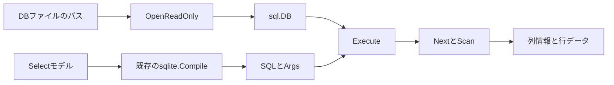

# M2-1: 生成したSELECTをSQLiteで実行する

## 状態とゴール

2026-11-08時点の次タスクの設計です。以下のAPI・ファイル・テストは未実装です。
この設計追加ではGoコードと依存関係を変更しません。

既存の`Select`をSQLiteに渡し、列情報と行データを受け取るところまでを実装します。
最初のデモは「activeがtrueでdeleted_atがNULLのユーザーを取得する」です。
SQLを表示する現在の例と、実際に結果を取得する例を並べて学べるようにします。

デモ用のusersテーブルはid・name・active・deleted_atを持ち、次の3行を用意します。

| id | name | active | deleted_at |
| --- | --- | --- | --- |
| 1 | Alice | 1 | NULL |
| 2 | Bob | 0 | NULL |
| 3 | Carol | 1 | 2026-11-01 |

既存例の検索条件・投影では、列が`id`と`user_name`、行が`[1, "Alice"]`の結果を期待します。
デモの日時は固定のテストデータで、現在時刻には依存させません。

スキーマ取得はM2-2、JOINはM3、MyGo GUIはM4、双方向編集はM5で維持します。
M2-1でリレーション、自動的なGo構造体へのマッピング、任意SQLの公開実行APIは追加しません。

## 学習の順序

1. 普通の関数: 名前、引数、戻り値を説明できるようにする。
2. `(Result, error)`: 成功結果と失敗理由を2つの戻り値で受け取る。
3. `*sql.DB`: DB操作に使うハンドルを引数で渡し、開く処理と実行する処理を分ける。
4. `defer`: 関数終了時にRowsやキャンセル用の資源を片付ける。
5. `Next`と`Scan`: 行を一つずつ読み、値をGo側へ受け取る。
6. `context.Context`: 呼び出し元の中止と制限時間を伝える。

最初から独自interfaceやRunner型は導入せず、責務を持つ普通の関数から始めます。
実装には`// 学習用:`で始まる日本語コメントを積極的に付けます。

## 処理の全体像



図は設計です。`Compile`の呼び出しは`Execute`の内部で行います。
`OpenReadOnly`の結果を閉じるのは呼び出し元、読み取り中のRowsを閉じるのは`Execute`です。

## パッケージと関数

| 予定ファイル | 役割 |
| --- | --- |
| `execution/result.go` | 結果の構造体と実行オプション |
| `execution/execute.go` | モデルのSQL化、実行、結果の収集 |
| `execution/execute_test.go` | 実SQLiteによる振る舞いのテスト |
| `storage/sqlite/open.go` | ドライバ登録と読み取り専用の接続設定 |
| `storage/sqlite/open_test.go` | パス、読み取り専用、接続失敗、接続解放のテスト |
| `examples/execute/main.go` | 既存DBから取得する初心者向けの実行例 |

ルートのQuery Modelと既存の生成器にはドライバのimportを追加しません。
実行層は`database/sql`を使い、ドライバ固有の設定は接続層へ寄せます。

設計する関数の宣言:

```go
// 学習用: ctxは中止の連絡、pathは開くファイル、戻り値はDBハンドルとエラーです。
func OpenReadOnly(ctx context.Context, path string) (*sql.DB, error)

// 学習用: dbと検索内容を受け取り、結果とエラーを返します。db自体は閉じません。
func Execute(ctx context.Context, db *sql.DB, query q.Select, options Options) (Result, error)
```

宣言は設計用の抜粋であり、そのまま実行できるコードではありません。
`q`はルートのQueryLabパッケージ、`sql`は標準ライブラリの`database/sql`です。

| 引数・戻り値 | 意味 |
| --- | --- |
| `ctx context.Context` | 呼び出し元から中止・期限を伝える |
| `db *sql.DB` | 開いてあるDB操作用ハンドル。実際には接続プールを管理する |
| `query q.Select` | 取得したい列や条件を持つ、既存のモデル |
| `options Options` | 結果件数の上限と制限時間 |
| `Result` | 列情報・行データ・途中打ち切りの有無 |
| `error` | 成功時はnil、失敗時は原因を返す |

## 結果とオプションの契約

予定するデータ型:

```go
type Column struct {
    Name             string
    DatabaseTypeName string
}

type Result struct {
    Columns   []Column
    Rows      [][]any
    Truncated bool
}

type Options struct {
    MaxRows int
    Timeout time.Duration
}
```

`Rows[行番号][列番号]`で値を参照します。列名をmapのキーにしないので、同名列も保持できます。
NULLはnil、値はドライバが返した型のまま受け取ります。宣言型に合わせたboolや日時への自動変換はしません。
バイト列は戻り値が所有するようコピーし、読み取り終了後も保持できるようにします。
`DatabaseTypeName`が得られない場合は空文字列とし、実際の値型と同一とはみなしません。
列ごとのNULL許容情報やスキーマ照合はM2-2へ送ります。

0件は成功で、列情報と空のRowsを返します。各行の要素数は列数と一致させます。
失敗時は`Result{}`とerrorを返し、途中までの行を成功結果として返しません。

`MaxRows=0`の既定値は1000行、`Timeout=0`は5秒です。どちらも負値はエラーにします。
初期版では無制限の指定は用意しません。既定値はQueryLabの設計判断であり、DBの仕様ではありません。
呼び出し元の期限が先なら、そちらが優先されます。ctxとdbがnilの場合もエラーにします。

## 実行アルゴリズムと資源管理

1. 引数・オプションを検査し、既定値を適用する。
2. `sqlite.Compile(query)`でSQLとArgsを生成する。不正モデルならDBへ問い合わせない。
3. `context.WithTimeout`で今回の期限を作り、`defer cancel()`を設定する。
4. `db.QueryContext(ctx, statement.SQL, statement.Args...)`で実行する。
5. Rows取得後、必ず閉じるための`defer rows.Close()`を設定する。
6. 列情報を取得し、`Next`で行を進め、`Scan`で各列の値を受け取る。
7. 新しい行の格納先を毎回作る。バイト列はコピーし、前の行との共有を避ける。
8. 上限行数を保持した後、もう1行あるかだけ調べる。存在すれば`Truncated=true`にして終了する。
9. 読み取り後の`Rows.Err()`と今回のcontextのエラーを確認する。
10. 成功を返す前に明示的にもRowsを閉じ、Closeのエラーを確認する。

SQLモデルのLIMITは変更しません。クエリが返す結果のうち、MaxRowsを超える行があるかを確認します。
ちょうどMaxRows行なら`Truncated=false`です。追加行の存在確認中のエラーも失敗として返します。
上限は保存する行数を抑えるもので、DBの処理量や1セルのバイト数全体を制限するものではありません。

キャンセル・期限切れはcontextのエラーをラップして返し、`errors.Is`で判定できるようにします。
それ以外のDB・Scan・Rows・Closeのエラーも段階を付けてラップします。
先に失敗した場合はそのエラーを優先し、deferでRowsを片付けます。DBプールは閉じません。
実行中の中止がどれだけ速く反映されるかは、採用ドライバの実テストで確認します。

読み取り処理の分析は、Rを保持する行数、Cを列数、Bをコピーする値の総バイト数として、
時間O(R×C+B)、結果の領域O(R×C+B)を目安とします。上限後の1行確認を含みます。
これはDBの検索時間・ソート時間・既存コンパイラの処理を含まない分析であり、実測値ではありません。

## 接続とドライバの判断

`OpenReadOnly`は通常のローカルファイルパスを受け取り、絶対パスにしてURIを構築します。
`net/url`で`?`や`#`などをエンコードし、読み取り専用の`mode=ro`を設定します。
任意のDSN、URIオプション、`:memory:`は公開APIの入力にしません。
接続プールは当面1接続に絞ります。開いた後に`PingContext`で確認し、失敗なら内部でCloseします。
成功した場合のClose責務は呼び出し元に移ります。
`Execute`は渡されたDBが読み取り専用かを検査しません。製品の接続は`OpenReadOnly`で作り、
テストのデータ準備用接続とは責務を分けます。

| 候補 | 一次資料で確認した特徴 | このプロジェクトでの判断 |
| --- | --- | --- |
| [modernc.org/sqlite](https://pkg.go.dev/modernc.org/sqlite) | CGO不要のSQLite実装 | Cのビルド設定を避けてGoの学習に集中できるため第一候補 |
| [mattn/go-sqlite3](https://github.com/mattn/go-sqlite3) | CGOとCコンパイラが必要 | 比較候補として残す。採用時はビルド環境の手順が必要 |

第一候補の決定と、特定バージョンの採用は分けます。
最初の実装ステップで、候補版のgo.mod、依存関係、対応OS/アーキテクチャ、保守状況を確認し、
Go 1.23という現行の宣言と整合する固定バージョンを決めます。
適切な版で整合しない場合は、Goの最低版またはドライバの選択を設計判断として再検討し、黙って変更しません。
現環境のGo 1.25.7で動くことだけを、最低版での動作確認の代わりにしません。

ドライバの導入前に、1回のSELECT、読み取り専用、キャンセルを小さな検証で確認します。
採用版・選定理由・Go条件・実行環境・確認結果を本書とレビュー資料に追記してから本体へ組み込みます。
未検証のキャンセル性能や配布容易性を、採用済みの保証として記載しません。

## 実装の分割と受け入れ条件

| 順番 | 小タスク | 完了の確認 |
| --- | --- | --- |
| 1 | ドライバの技術検証と版固定 | Go条件・接続・読み取り専用・中止の確認結果を記録 |
| 2 | 接続関数と結果モデル | 通常パスと特殊文字のあるパス、存在しないDB、Close責務を確認 |
| 3 | 最小のExecute | 1行・複数行・0行、列順・同名列・NULLを保持して返す |
| 4 | 上限・期限・失敗時の後始末 | 上限境界、キャンセル、読取エラー後にも再実行できることを確認 |
| 5 | 実行例・解説・レビュー資料 | SQL生成のみの例との差を説明し、結果を再現できる |

テストは一時ファイルDBを使い、セットアップ専用の書き込み接続でデータを用意した後に閉じます。
そのDBを製品の読み取り専用関数で開いて実行します。実ドライバのテストはCLI不足を理由にスキップしません。

必須ケースは以下です。

- 通常のSELECT、SQLへの文字列注入を意図した値のバインド、列順・同名列・NULL・値型。
- 0行、モデルのLIMIT=0、MaxRowsの既定値・負値・直前・一致・超過。
- 読み取り専用接続からの書き込み拒否と、存在しないDBが作成されないこと。
- 閉じたDB、存在しないテーブル、検証エラー、事前キャンセル、実行中キャンセル、期限切れ。
- 返したバイト列の独立性と、失敗後にも1接続のプールで再問い合わせできること。
- Rowsの読取・Scan・Close失敗経路。実DBで再現しにくい経路だけ、最小のテスト用ドライバを検討する。

実行中キャンセルは、時間のかかるテスト用view等を使い、開始の同期とテスト全体の期限を設定します。
固定時間のsleepだけで「実行中だった」と判定せず、どの段階を中止できたかを記録します。

実装後の確認コマンドは`go test ./...`、`go vet ./...`、`go test -race ./...`です。
再現可能なサンプルDBの作成手順と`go run ./examples/execute <DBファイル>`をREADMEへ追加します。
これは将来のコマンド仕様であり、現在は実行できません。

## 一次資料

仕様確認日: 2026-11-08。設計の背景に使った資料です。

- [`database/sql`（Go 1.25.7）](https://pkg.go.dev/database/sql@go1.25.7): DB、QueryContext、Rows、Scan、Close、context対応の契約。
- [SQLite URI](https://www.sqlite.org/uri.html): 読み取り専用接続の`mode=ro`。
- ドライバの公式説明は上記の比較表を参照。特定版の互換性と実動作は未検証です。
